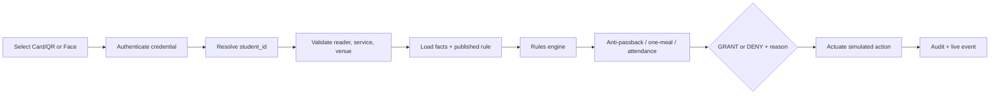

# KIU-USCAS — System Architecture

> Prototype. All data is fictional. Not approved by, or integrated with, Kampala International University systems.

Source specifications: see [`docs/reference/`](reference/) and [REQUIREMENTS_TRACEABILITY.md](REQUIREMENTS_TRACEABILITY.md).
The original 41-page KIU project guide is **not** in the repository (see [DECISIONS.md D-001](DECISIONS.md)).

## 1. Principle

One student identity, one rules engine, many credentials. A card (virtual AES tap), a rotating QR, or an opt-in face
are three ways of *proving who the student is*. They all resolve to the same `student_id` and call the same
`POST /api/v1/access/verify`, which applies the same versioned rules and writes the same audit/usage records.
A credential **never** grants eligibility; the card carries no balances or permissions.

## 2. Five layers

Editable source: [`diagrams/architecture-layers.mmd`](diagrams/architecture-layers.mmd)

| Layer | Contents | Trust boundary |
|---|---|---|
| 1 Credentials | Virtual AES card (simulator), rotating Ed25519 QR (`KIU1.payload.sig`, 30 s), opt-in face | Untrusted input |
| 2 Readers | Reader PWA (gate, library, exam, hostel, cafeteria, lab), IndexedDB signed cache + queued logs | Authenticated device, HMAC-signed requests |
| 3 Transport | TLS 1.2+, HMAC-SHA256 + timestamp + nonce, MQTT with per-reader ACLs, WebSocket for dashboards | Network |
| 4 Platform | NestJS API, credential verifier, rules engine, PostgreSQL, Redis, **separate** BiometricIdentityService | Trusted |
| 5 University feeds | Finance, Registry, Library, Hostel via CSV/Excel import, mock adapters, optional webhooks | Validated input, idempotent |

## 3. Monorepo layout

```
apps/
  api/            NestJS (implemented: auth, RBAC, audit, users, students, health)
  admin/          Next.js admin console              (Phase 6, not started)
  student-portal/ Vite + React PWA: wallet, rotating QR, eligibility, history (implemented, D-024)
  reader/         Vite + React PWA: QR scan, online-first + offline, result UI (implemented; tap/face disabled)
  simulator/      HTTP-only wallet/reader + 14 scenarios, CLI (implemented; web UI Phase 5/6)
packages/
  shared/         roles, permissions, reason codes   (implemented)
  security/       AES-256-GCM envelopes, HMAC, hash chain (implemented)
  rules-engine/   JSON rules evaluator               (implemented)
  vcard/          AES-CMAC, key diversification, tap protocol, Ed25519 QR, device PoP (implemented)
  offline-core/   offline decision engine (implemented)   ui/ tokens.css + components (implemented)
  validation/ types/                                 (as needed)
services/
  biometric-engine/  Python/FastAPI adapter service  (Phase 6, mock adapter first)
prisma/           schema.prisma + SQL migrations
infrastructure/   docker, mosquitto, scripts (embedded-PG helpers)
docs/             this documentation
```

## 4. Backend module map (`apps/api/src/modules`)

| Module | Status | Responsibility |
|---|---|---|
| auth | ✅ | Login (Argon2id), lockout, TOTP MFA + recovery codes, refresh rotation + reuse detection, password reset/change, cookie+CSRF or bearer |
| audit | ✅ | Append-only, hash-chained audit trail; `GET /audit`, `GET /audit/verify` |
| users / roles | ✅ | Staff accounts, role assignment with escalation controls |
| students | ✅ (core) | List/search/create/status; fail-closed initial facts |
| health | ✅ | `/health` with DB probe |
| access (QR + TAP pipeline), tap (SAM), rules, readers, alerts | ✅ | Decision pipeline: reader HMAC auth → credential → lifecycle → rule → log |
| cards | ✅ API | Issue, activate (device PoP), block/unblock, lost, replace, history, student self-service |
| biometrics | Phase 6 | Enrolment, consent, assertions |
| offline-sync, integrations, reports, notifications, services | Phases 5–8 | |

## 5. Request pipeline (implemented)

```
request → request-id → helmet/CORS → throttler → AuthGuard → PermissionsGuard → ValidationPipe → controller → service → Prisma tx (+ audit entry) → AllExceptionsFilter
```

* **AuthGuard** verifies the HS256 JWT (`sub`, `sid`), then re-loads the session + roles + permissions from PostgreSQL on every
  request. Revocation, suspension and role changes are therefore effective immediately, not at token expiry.
* **PermissionsGuard** is deny-by-default: a route must declare `@Public()`, `@Authenticated()` or `@RequirePermissions()`.
* Business change and audit entry are written in **one transaction**; a rolled-back change leaves no audit row.

## 6. Access decision flow (Phase 3)

Sequence: [`diagrams/access-verify-sequence.mmd`](diagrams/access-verify-sequence.mmd) ·
Decision tree: [`diagrams/decision-tree.mmd`](diagrams/decision-tree.mmd) ·
Offline: [`diagrams/offline-sequence.mmd`](diagrams/offline-sequence.mmd)



Face mode inserts *capture → quality → liveness → template match → confidence policy* before “Resolve student_id”, performed by
the separate biometric service, which returns a **signed, short-lived assertion** bound to reader, nonce and time.
The access API never accepts a plain `student_id` from a client.

## 7. Policy: card state vs. face credential (BIO amendment §21)

Credential revocation ≠ account suspension.

| Situation | Card/QR | Face | Reason |
|---|---|---|---|
| Card LOST/BLOCKED, student ACTIVE, face enrolled & consented | DENY `CARD_LOST/BLOCKED` | May proceed to rules | Face is an independent credential |
| Student account SUSPENDED/WITHDRAWN | DENY | DENY `STUDENT_SUSPENDED` | Account-wide |
| Face consent withdrawn / template revoked | n/a | Unavailable; non-biometric route stays open | BIO consent rules |
| Lost card presented | DENY + HIGH security alert | — | PDF §10 |

Test IDs: FACE-06, TC-04. Configurable per institution (`biometric_policies`).

## 8. Offline model

Readers are online-first; after ≈800 ms they may decide locally **only** where `Service.offlinePolicy = CACHED_ALLOW`
(seeded: GATE only). The cache is a signed, versioned manifest with a short `validUntil` and a revocation version.
EXAM, CAFETERIA and the rest default to `DENY_ALL` offline. A disconnected reader cannot learn of revocations issued after
its last sync; this is documented, bounded by `validUntil`, and surfaced as `OFFLINE_CACHE_STALE`. Face is **online-only**; no
templates are cached on browser readers.

## 9. Runtime topology

Dev: `docker compose up` (PostgreSQL 17, Redis 7, optional Mosquitto) **or** `pnpm db:dev` (embedded PostgreSQL, no Docker).
Redis is optional in dev; the API degrades to PostgreSQL. Production notes live in the (Phase 10) deployment guide.

## 10. 3D-style illustration storyboard (Phase 5/6/9)

Authored as CSS/SVG isometric components in `packages/ui`; React Three Fiber only for one optional interactive campus map with
a static fallback. Critical flows never depend on WebGL.

1. Campus hero — isometric gate, library, exam hall, hostel, cafeteria, lab around a central card + server; buildings clickable.
2. Two identity paths — Virtual card/QR and Live face/Biometric engine converge on one student identity and one rules engine.
3. Five-layer architecture with request/response/sync arrows (includes encrypted template store + separate biometric service).
4. Student day — seven interactions; allowed cafeteria meal then denied second meal.
5. Virtual tap protocol — SELECT → challenge → mutual auth → encrypted read → signed request → decision (sanitised logs).
6. QR verification — countdown → scan → Ed25519 → nonce/counter → eligibility → decision.
7. Card-forgotten scenario — gate → Face Scan → liveness → identity → rules → grant/deny reason → log.
8. Decision tree (see §6) with specific denial branches; liveness-failure / ambiguous-match / consent-withdrawal tree.
9. Offline mode; lost-card lifecycle; biometric enrolment & deletion lifecycle.
