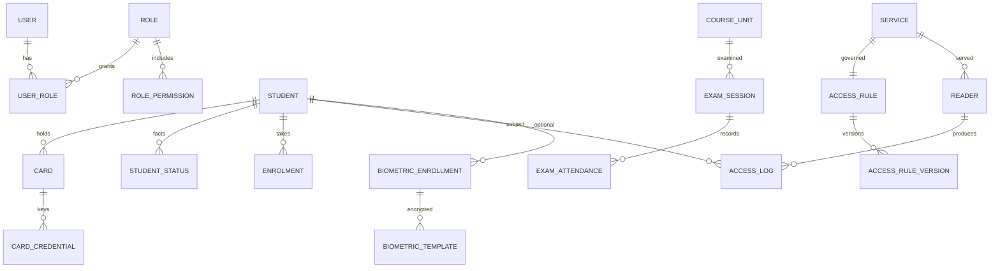

# KIU-USCAS — Database Design

Source of truth: [`prisma/schema.prisma`](../prisma/schema.prisma) (57 tables) + hand-written SQL in
[`prisma/migrations/0002_constraints`](../prisma/migrations/0002_constraints/migration.sql). ERD source: [`diagrams/erd.mmd`](diagrams/erd.mmd).

## Table groups

| Group | Tables |
|---|---|
| Accounts / RBAC | `users`, `roles`, `permissions`, `user_roles`, `role_permissions`, `sessions`, `password_reset_tokens` |
| Academic | `departments`, `programmes`, `academic_sessions`, `semesters`, `students`, `student_status`, `course_units`, `enrolments`, `venues`, `exam_sessions`, `exam_seats`, `lecture_schedules` |
| Cards | `cards`, `card_credentials`, `card_events`, `card_revocations`, `credential_nonces` |
| Biometrics (schema only until Phase 6) | `biometric_enrollments`, `biometric_templates`, `biometric_consents`, `biometric_attempts`, `biometric_model_versions`, `biometric_policies`, `biometric_revocations`, `biometric_device_authorizations` |
| Services / rules | `services`, `access_rules`, `access_rule_versions` |
| Readers | `readers`, `reader_credentials`, `reader_heartbeats`, `reader_cache_versions`, `offline_log_batches` |
| Decisions | `access_logs`, `access_overrides`, `security_alerts`, `presence_state` |
| Service records | `exam_attendance`, `lecture_attendance`, `library_loans`, `hostels`, `hostel_allocations`, `meal_sittings`, `meal_usage`, `service_memberships`, `graduation_clearances` |
| Operations | `sync_jobs`, `notifications`, `audit_trail`, `system_settings` |

## Integrity rules enforced by PostgreSQL (all covered by `db-constraints.e2e.ts`)

| Rule | Mechanism |
|---|---|
| ≤ 1 ACTIVE card per student (also under concurrent issuance) | partial unique index `cards_one_active_per_student` |
| Unique registration no., card number, UID, reader code | unique indexes |
| UID = 14 hex (7 bytes), AID = 6 hex (`4B4955`), counter ≥ 0, ACTIVE ⇒ `issued_at` | CHECK |
| 0 ≤ fees% ≤ 100, non-negative fines/overdue, year 1–7 | CHECK |
| No duplicate exam attendance (QR or face) | unique `(exam_session_id, student_id)` |
| One meal per student per sitting per day | unique `(student_id, sitting_id, served_on)` |
| One active hostel allocation per student | partial unique index |
| Exam window coherent | CHECK `starts_at < ends_at`, entry window ordered |
| **Audit trail append-only** | trigger rejects UPDATE/DELETE/TRUNCATE |
| Access logs immutable (retention may DELETE) | trigger rejects UPDATE |
| Idempotent offline uploads | unique `offline_log_batches.idempotency_key`, `access_logs.idempotency_key` |

## Conventions

* UUID PKs via `gen_random_uuid()`; `timestamptz` everywhere; columns `snake_case` (`@map`).
* Secrets at rest use AES-256-GCM envelopes (`v1.iv.tag.ct`) with context AAD (e.g. `user:<id>`): `mfa_secret_enc`, `card_credentials.secret_enc`, `reader_credentials.secret_enc`.
* Refresh tokens, reset tokens: only SHA-256 stored.
* Eligibility **facts** (`student_status`) are per semester and default fail-closed (nothing cleared). Policy **thresholds** live in versioned rules, not in columns.
* Audit trail: `prev_hash`/`hash` chain over a canonical JSON payload; appends serialised by `pg_advisory_xact_lock`.

## Deferred / known limitations

* **`access_logs` partitioning** (monthly) is not yet applied: Prisma cannot model partitioned PKs cleanly. Planned as raw-SQL migration in Phase 9 with the retention job ([DECISIONS D-007](DECISIONS.md)). Indexes on reader/card/student/time exist now.
* Biometric tables are created but unused until Phase 6.
* Retention schedule values are placeholders pending KIU policy (Uganda DPPA 2019).
